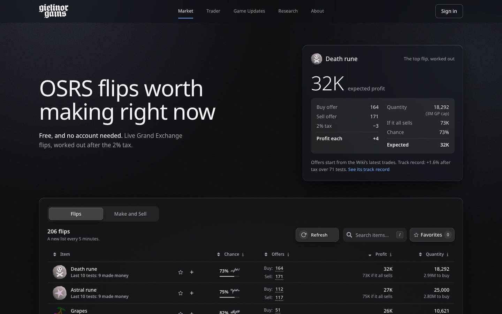
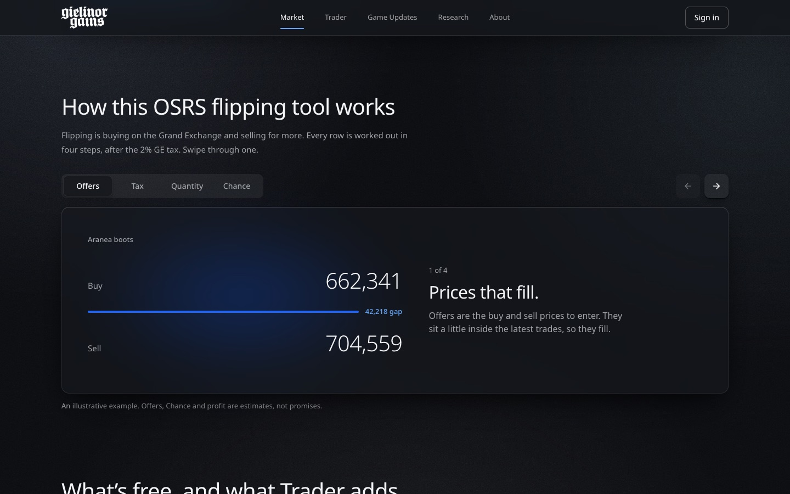
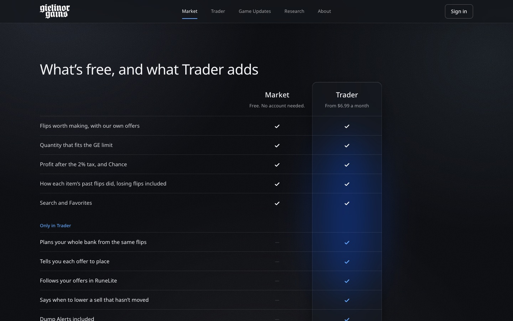
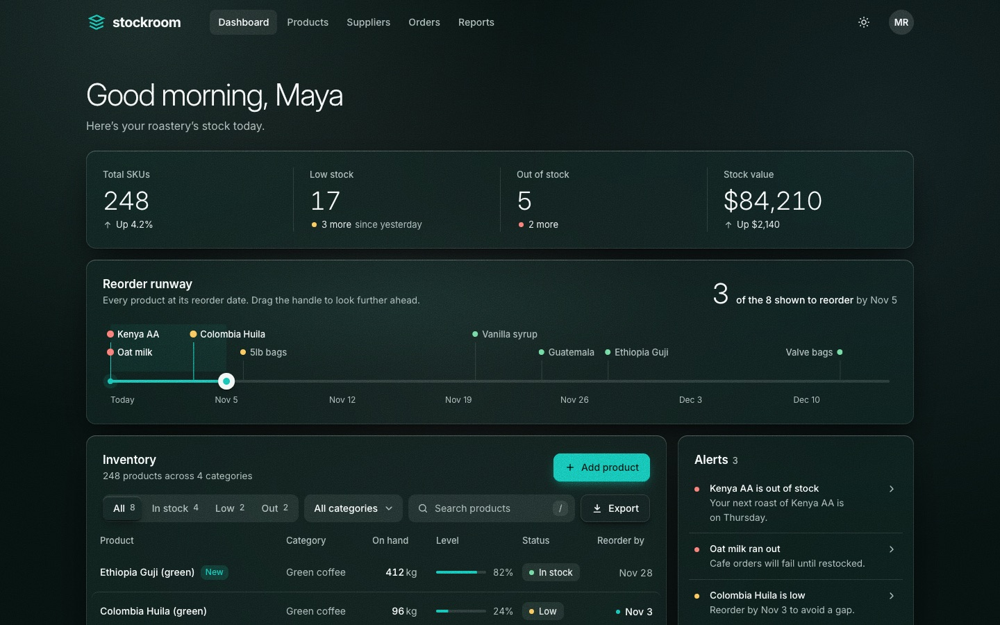
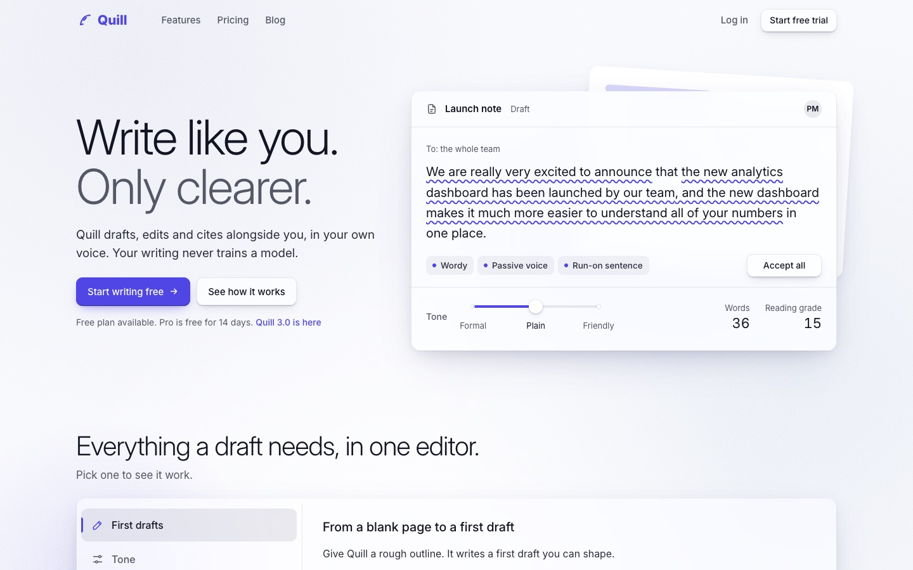
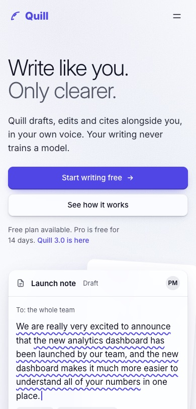
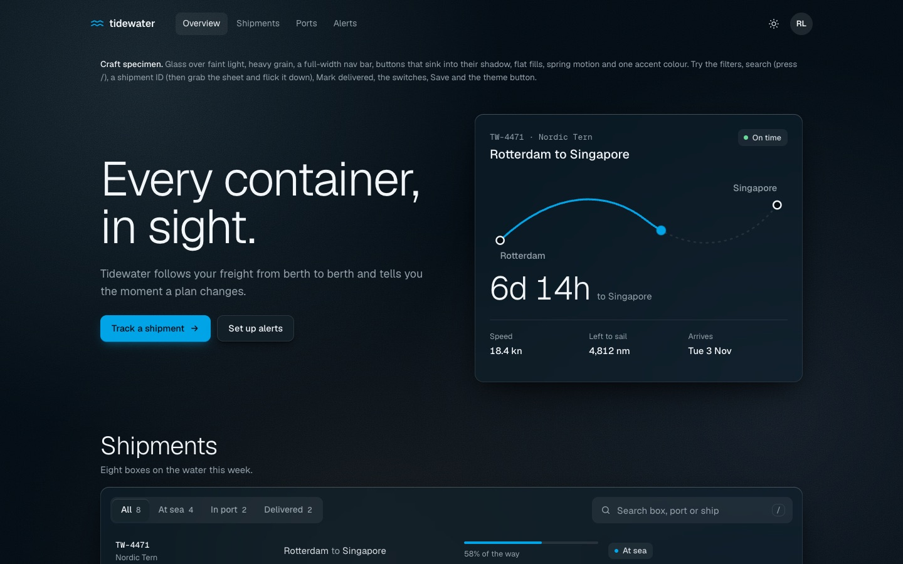

# craft

A [Claude Code](https://claude.com/claude-code) skill for designing, building and redesigning web UI to the standard of Apple, Linear, Stripe and Vercel for craft, and Disney's Imagineers for delight: pages that work without bugs, have nothing a careful eye would circle, and feel like magic to use.

## Made with craft

Each of these was built or redesigned by Claude using this skill, start to finish.

**Gielinor Gains**, a test redesign of a real Old School RuneScape trading site's homepage (not shipped): a live top flip that tilts toward your pointer and rolls its numbers into place, and the Market in one glass panel.



Its "how it works" became a stage you can swipe, where one example trade builds itself step by step, and its free-versus-paid list became a comparison whose ticks draw in as you scroll.

| | |
| --- | --- |
|  |  |

**Stockroom**, a test inventory dashboard, restyled. Its wow moment is the reorder runway: drag the teal handle along the dates, and a count rolls, pins light up and the matching rows get marked.



**Quill**, a test writing-app landing page, overhauled. The hero is a live editor: Accept all applies the edits one by one while the reading grade rolls from 15 down to 5, and a tone dial you can flick rewrites the paragraph.

| | |
| --- | --- |
|  |  |

**Tidewater**, the skill's own specimen (`assets/specimen.html`): the whole house style in one page, in light and dark. A route that draws itself, a sheet you can grab and flick, switches that squish, Save that morphs into a check.



Screenshots can't show the motion and touch, which are half the point. Open `assets/specimen.html` in a browser to feel it.

## How it works

It drives Claude to the whole bar by judgement, not by ticking rules. `SKILL.md` gives seven equally important principles:

1. **It works.** No bugs, at every width, in every state, at the extremes.
2. **Nothing looks off.** Nothing a careful designer would circle.
3. **Every state is designed and seen.** Hover, press, focus, loading, empty, error and more, all rendered and looked at.
4. **It's magic, not just nice.** Staged the way Imagineers stage a park: one thing the eye goes to, a reveal, a delight added to every section, nothing that breaks the spell, and one wow moment someone would send a friend.
5. **It's a joy to touch.** Things press, spring, follow your hand and settle; numbers roll; frequent actions never wait.
6. **The brand leads, and the product is the hero.**
7. **Accessible, fast and honest.**

It adds a house style (glass you can see through over faintly lit backgrounds, film grain on the background only, soft defined corners, buttons that sink into a shadow, springy motion), and a workflow that makes Claude actually look at its work. It renders every state at four widths, uses the page by pointer and touch, takes a wow test, and fixes what it finds. Then it hands the result to fresh reviewers: a demanding owner who judges it in the first ten seconds, and a breaker who uses it until something fails. Specific mistakes from past runs live in `references/traps.md` as examples, not as the whole list.

## What's inside

- `SKILL.md`: the principles, house style and workflow.
- `scripts/` (Node 22+ and Chrome, no installs):
  - `capture.mjs`: every section at each width, scripted states, motion frames and 3x zooms.
  - `audit.mjs`: contrast, focus rings, target sizes, overflow, reduced motion, table alignment, grain placement and more.
  - `gate.mjs`: checks the evidence for "done" exists before reporting.
- `references/`: tokens, components, motion and the joy kit, `magic.md` (from nice to wow, after Disney Imagineering), exemplars from great products, reviewer briefs and the known traps.
- `assets/specimen.html`: the house style working in light and dark.
- `evals/`: three test cases with graders, in the layout `claude plugin eval` reads.

## Install

As a personal skill, available in every Claude Code session on your machine:

```bash
git clone https://github.com/cameronspears/claude-skills ~/claude-skills
```

```bash
mkdir -p ~/.claude/skills && ln -s ~/claude-skills/craft ~/.claude/skills/craft
```

Or for one project, so everyone working on it gets it, copy the folder in from the project's root:

```bash
mkdir -p .claude/skills && cp -R ~/claude-skills/craft .claude/skills/craft
```

Then ask Claude to redesign, polish or build a page, or type `/craft`.

## Using it

Expect long runs. A full redesign takes Claude one to two hours: it captures hundreds of screenshots, fixes what it finds, and runs up to three review rounds. It ends with a page you can use, not just screenshots, because motion and touch can't be judged from stills.

On a redesign it asks first whether you want a **restyle** (same sections and copy, new look) or an **overhaul** (shorter copy, sections rethought). If nobody can answer, it overhauls persuading pages and restyles working tools.

The scripts open headless Chrome. Run them one at a time on machines with limited memory.

## Credits

The skill paraphrases and adapts ideas from Anthropic's frontend-design skill, Paul Bakaus's Impeccable, Emil Kowalski, Jakub Krehel, Leonxlnx's taste-skill, Dammyjay93's interface-design, Vercel's Web Interface Guidelines, Rauno Freiberg, Apple's Human Interface Guidelines, Josh W. Comeau and others, and the delight principles from Disney Imagineering (Marty Sklar's "Mickey's Ten Commandments"). The full list with licences is in `references/review.md` ("Sources and licences"). The code is original.

## Licence

MIT. See [`LICENSE`](../LICENSE).
